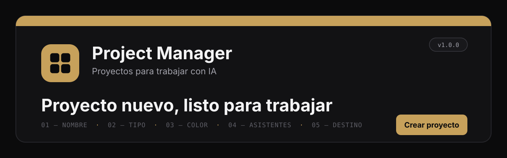
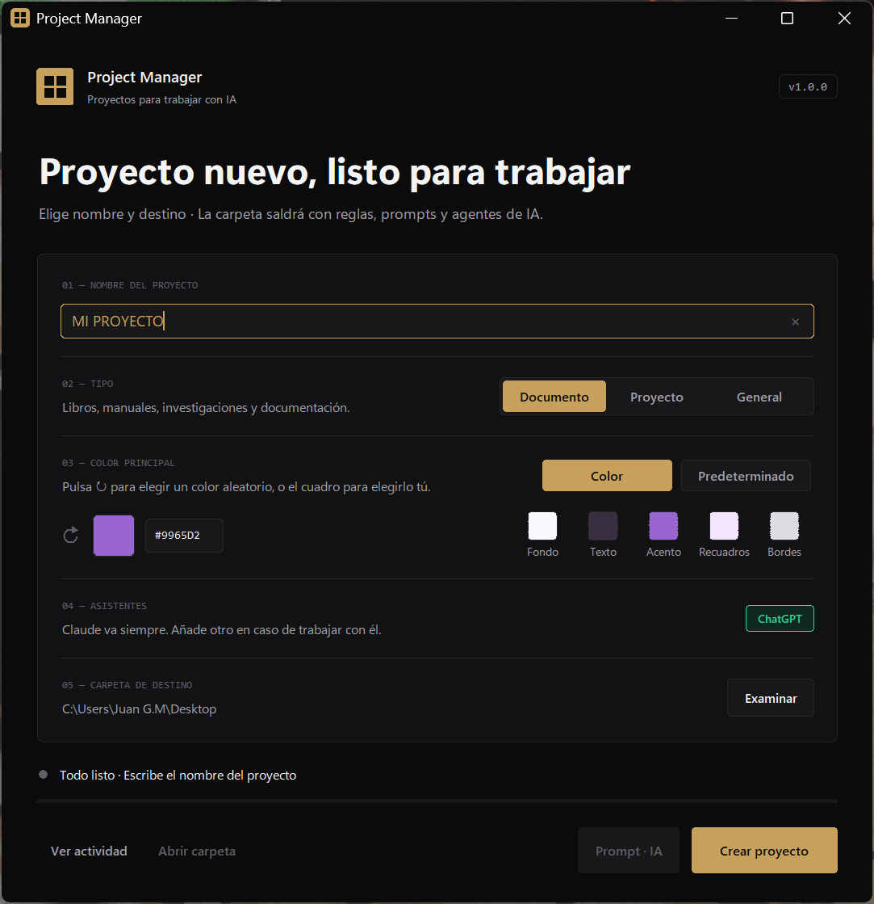

<p align="center">
  
</p>

<p align="center">
  
  
  
  
</p>

<p align="center">
  <b>Crea en un clic la carpeta de un proyecto nuevo, lista para trabajar con IA.</b><br>
  Escribe el nombre, elige tipo, color y destino, y pulsa <b>Crear proyecto</b>.<br>
  La carpeta sale ordenada, con reglas, prompts y agentes de IA (Claude y, si quieres, ChatGPT con Codex).
</p>

<p align="center">
  
</p>

---

## Índice

- [Por qué existe](#por-qué-existe)
- [Qué hace](#qué-hace)
- [Los tres tipos de proyecto](#los-tres-tipos-de-proyecto)
- [Requisitos](#requisitos)
- [Instalación](#instalación)
- [Cómo se usa](#cómo-se-usa)
- [Cambiar la plantilla](#cambiar-la-plantilla)
- [Estructura del proyecto](#estructura-del-proyecto)
- [Tecnologías](#tecnologías)
- [Diseño](#diseño)
- [Próximamente](#próximamente)
- [Autor](#autor)
- [Licencia](#licencia)

---

## Por qué existe

Cada vez que se empieza un proyecto con una IA hay que volver a explicarle lo mismo: cómo se llaman las carpetas, cómo se escribe, dónde se guarda lo terminado, qué se ha hecho ya y qué falta.

Project Manager lo deja escrito desde el primer minuto. Cada proyecto nuevo trae sus reglas, su estado y un prompt de inicio con la ruta ya puesta. Un chat nuevo lee esos archivos y continúa donde se quedó el anterior, sin depender de la memoria de la conversación.

## Qué hace

| | |
|---|---|
| **Tres tipos** | **Documento**, **Proyecto** y **General**, de lo más completo a lo más sencillo. Cada uno trae solo lo que necesita. |
| **Prompt de arranque** | `00_INICIO_CHAT.md` lleva solo el primer mensaje para Claude, con la ruta del proyecto ya escrita: se copia o se adjunta entero en un chat nuevo y la IA sabe qué hacer. El botón **Prompt · IA** lo copia. |
| **Reglas para la IA** | `AGENTS.md` con las reglas de trabajo, las **normas de nombres** de carpetas y archivos y las **reglas de escritura** (basadas en la guía de Wikipedia sobre los rasgos del texto escrito por IA). |
| **Memoria en archivos** | `AGENT_AI/ESTADO.md` dice dónde se quedó el trabajo y qué sigue. Los tipos Documento y Proyecto añaden plan y bitácora. |
| **Color principal** | Elige un color con el selector propio (cuadro de saturación y brillo, barra de tono y código), pulsa **↻** para uno al azar o usa el **Predeterminado**. Debajo se ve en vivo la paleta que sale de él. |
| **Paleta desde un color** | De un solo color se calculan 13 tonos (fondo, texto, acento, recuadros, bordes…) con el contraste comprobado, para que el documento final se lea bien. |
| **ChatGPT opcional** | El interruptor **ChatGPT** (verde = activado) añade las reglas y la bitácora de Codex. Claude va siempre. |
| **Sin carpetas a medias** | El proyecto se crea primero en una carpeta temporal y solo recibe su nombre al final. Si algo falla, no queda nada a medias y la ventana dice qué ha pasado. |
| **Actividad** | El botón *Ver actividad* muestra lo que hace el programa, con un icono para copiarlo. Si hay un error, se abre solo. |

## Los tres tipos de proyecto

| Tipo | Para qué | Qué añade |
|---|---|---|
| **Documento** | Libros, manuales, investigaciones y documentación. | Ficha con la paleta, plan, bitácora de Claude, `01_MATERIALS/` (tu material), `02_WORK/` (borradores), `03_EXPORT/` (lo terminado) y el **manual de estilo** con su generador de PDF. |
| **Proyecto** | Software, aplicaciones, páginas web y desarrollo. | Lo necesario para Git y GitHub: `README.md`, `CHANGELOG.md`, `.gitignore`, `LICENSE` (GPL-3.0), `CLAUDE.md`, guía de prompts, `docs/`, `tests/` y `AGENT_AI/` completo, con asesor (app de escritorio) y ejecutor (Claude Code) separados. |
| **General** | Cualquier otro trabajo. | Lo mínimo para empezar: reglas, estado y la carpeta `01_WORK/`. |

Todos llevan `README.md`, `00_INICIO_CHAT.md` (el prompt de arranque), `AGENTS.md`, `00_CONFIG/` (reglas de escritura y normas de nombres) y `AGENT_AI/ESTADO.md`.

## Requisitos

- **Windows 10 u 11**
- **[Python 3.10 o posterior](https://www.python.org/downloads/)** (marca *Add Python to PATH* al instalarlo). Ya trae Tkinter: no hace falta instalar nada más.
- *(Opcional)* `reportlab`, solo para volver a generar el PDF del manual de estilo: `pip install reportlab`

## Instalación

1. Descarga el proyecto: botón verde **Code → Download ZIP**, o la última versión en **[Releases](../../releases)**.
2. Descomprímelo donde quieras.
3. Abre **`01_CREAR_PROYECTO.cmd`** y se abrirá la ventana.
4. *(Opcional)* Abre **`02_CREAR_ACCESO_DIRECTO.cmd`** para tener Project Manager en el escritorio con su icono.

## Cómo se usa

1. **01 · Nombre del proyecto**: por ejemplo «Mi proyecto». La carpeta se llamará `MI_PROYECTO` (mayúsculas, sin tildes y con `_` en lugar de espacios).
2. **02 · Tipo**: Documento, Proyecto o General.
3. **03 · Color principal**: pulsa el cuadro para elegirlo, escribe el código (`#RRGGBB`) o pulsa **↻** para uno al azar. **Predeterminado** usa la paleta del sistema.
4. **04 · Asistentes**: Claude va siempre. Activa **ChatGPT** si también trabajas con él.
5. **05 · Carpeta de destino**: dónde se creará el proyecto. Se recuerda para la próxima vez.
6. Pulsa **Crear proyecto**. Se abre la carpeta nueva.
7. Pulsa **Prompt · IA** y pega el prompt como primer mensaje en un chat nuevo de Claude. También puedes adjuntar `00_INICIO_CHAT.md` tal cual. El `README.md` de cada proyecto (en Proyecto, `AGENT_AI/LEEME.md`) explica cómo empezar sin acceso a la carpeta.

También funciona desde la consola:

```bat
python APP\creador.py --nombre "Mi proyecto" --tipo DOCUMENTO --destino "C:\ruta" --color "#2E7D6B"
python APP\creador.py --nombre "Mi app" --tipo PROYECTO --destino "C:\ruta" --codex
```

> [!TIP]
> Para que tu nombre y tu usuario de GitHub salgan en los proyectos, abre `APP\projectmanager_ajustes.json` (se crea con tu primer proyecto) y rellena los campos `"autor"` y `"github"`.

## Cambiar la plantilla

Todo lo que se copia a cada proyecto está en `PLANTILLA\`. Los textos llevan etiquetas que se rellenan al crear el proyecto:

| Etiqueta | Se cambia por |
|---|---|
| `[PROYECTO]` | El nombre, tal como lo escribiste |
| `[CARPETA]` · `[RUTA]` | El nombre de la carpeta y su ruta completa |
| `[TIPO]` · `[COLOR]` | El tipo de proyecto y el color principal |
| `[FECHA]` · `[FECHA_ISO]` | La fecha de hoy (`07/11/2026` y `2026-11-07`) |
| `[AUTOR]` · `[GITHUB]` | Tu nombre y tu usuario de GitHub |

Los bloques `[[SI DOCUMENTO]] … [[FIN]]` solo aparecen en ese tipo (también `PROYECTO`, `GENERAL` y `CODEX`, y varios a la vez: `[[SI DOCUMENTO|GENERAL]]`). `[[NO CODEX]] … [[FIN]]` aparece solo cuando ChatGPT está desactivado.

## Estructura del proyecto

```
PROJECT_MANAGER
├── 00_LEEME.txt                  Instrucciones rápidas
├── 01_CREAR_PROYECTO.cmd         Abre la ventana
├── 02_CREAR_ACCESO_DIRECTO.cmd   Acceso directo en el escritorio
├── APP\
│   ├── interfaz.py               Ventana (Tkinter)
│   ├── creador.py                Lógica: copia la plantilla y rellena las etiquetas (también modo consola)
│   ├── crear_acceso_directo.ps1  Crea el acceso directo
│   └── projectmanager.ico        Icono
├── PLANTILLA\                    Lo que se copia a cada proyecto
│   ├── 00_MODULOS\               Lo que comparten los tipos
│   │   ├── ESCRITURA\            Normas de nombres y reglas de escritura
│   │   └── MANUAL\               Manual de estilo, su PDF, prompts y generador
│   ├── 01_GENERAL\
│   ├── 02_DOCUMENTO\
│   └── 03_PROYECTO\              Incluye la licencia GPL-3.0
├── tests\                        Pruebas automáticas del creador
├── docs\                         Imágenes del README
├── README.md
├── CHANGELOG.md
└── LICENSE
```

Pruebas automáticas:

```bat
python -m unittest discover tests
```

## Tecnologías

| | |
|---|---|
| **Python 3** | Lenguaje del programa, sin paquetes externos |
| **Tkinter** | Ventana de escritorio, con diseño propio |
| **unittest** | Pruebas automáticas del creador (los tres tipos, con y sin ChatGPT) |
| **ReportLab** *(opcional)* | Genera el PDF del manual de estilo |

## Diseño

Fondo grafito monocromo y un solo color de señal, el dorado. Es el mismo sistema que mis otros programas, VideoFetch y StreamFetch.

| Color | Uso |
|---|---|
|  `#0B0B0C` | Fondo |
|  `#121214` | Tarjetas |
|  `#F4F4F5` | Texto |
|  `#A1A1AA` | Texto secundario |
|  `#C7A15B` | Acento: botón *Crear proyecto* y opciones elegidas |

## Próximamente

- [x] Tres tipos de proyecto: Documento, Proyecto y General (v1.0.0)
- [x] Selector de color propio y paleta en vivo (v1.0.0)
- [x] Pruebas automáticas del creador (v1.0.0)
- [x] Prompt de arranque de un solo mensaje, listo para copiar o adjuntar (v1.1.0)
- [ ] Botón «Actualizar ruta» para un proyecto que se ha movido de carpeta
- [ ] GIF de la aplicación en marcha
- [ ] Versión `.exe` que no necesite Python instalado

## Autor

| | Papel | GitHub |
|---|---|---|
| **Juan Bautista Galisteo Marqués** | Autor y responsable del proyecto | [@juangalisteo](https://github.com/juangalisteo) |

## Licencia

Distribuido bajo la **Licencia Pública General de GNU v3.0** (GPL-3.0 o posterior). Consulta el archivo [LICENSE](LICENSE).

Puedes usar, estudiar, compartir y modificar Project Manager. Si repartes una versión modificada, también tiene que publicarse bajo la GPL y con su código fuente.

Las fuentes Inter del manual de estilo se distribuyen con su propia licencia, la SIL Open Font License (`PLANTILLA/00_MODULOS/MANUAL/03_SOURCE/03_FONTS/OFL.txt`).

Copyright © 2026 Juan Bautista Galisteo Marqués.

<p align="center"><sub>Project Manager v1.1.0 · Juan Bautista Galisteo Marqués</sub></p>
